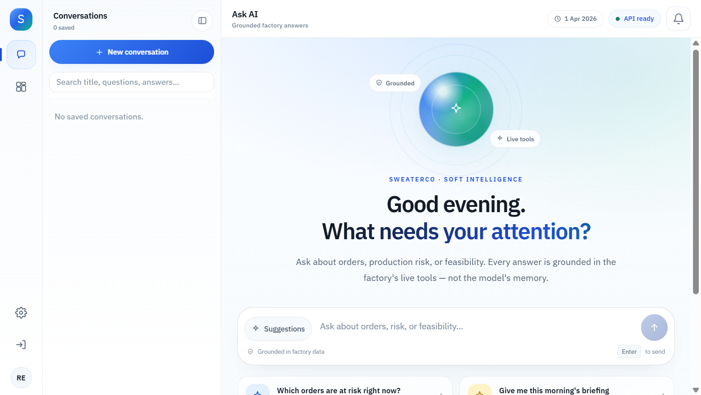
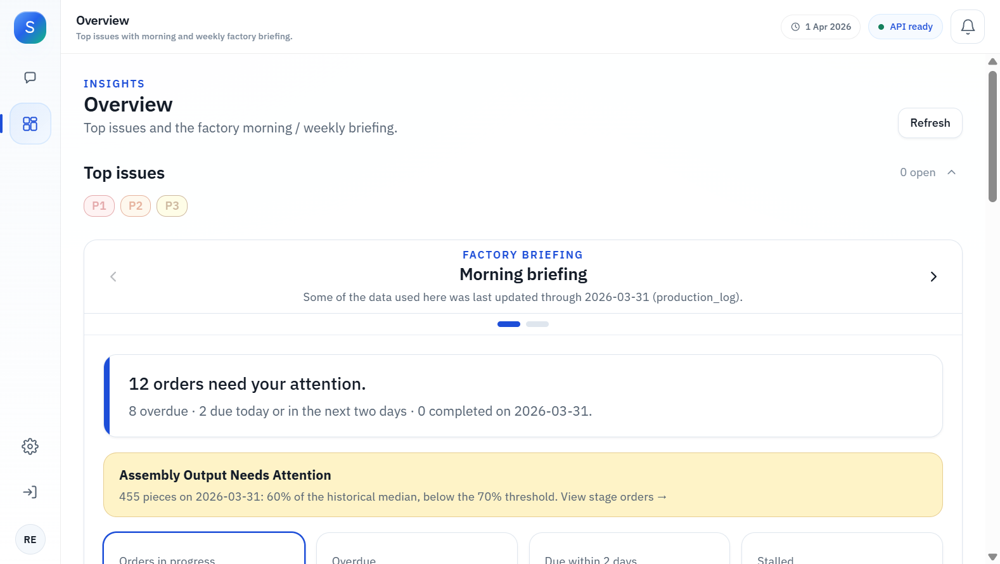
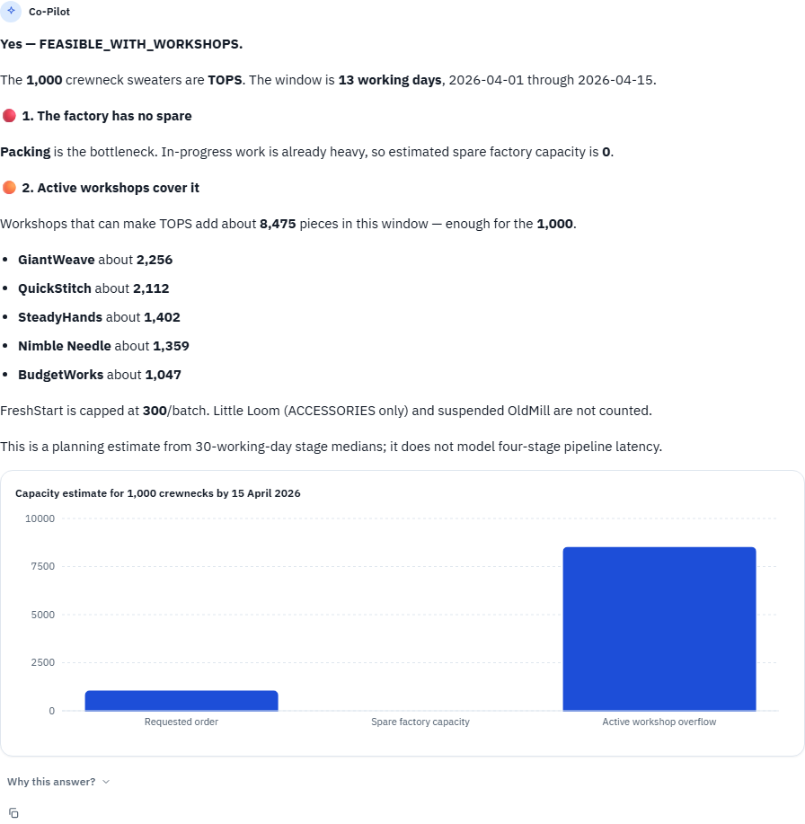
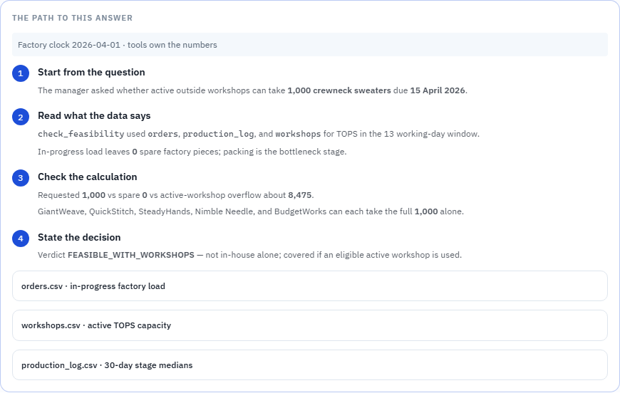

# SweaterCo — The General Manager's Co-Pilot

**DSS5105 Data Science Project for Practice · Track 1 · Group 10**

[GitHub Repository](https://github.com/XTC917/DSS5105_26fall_Group10_TheGeneralManager-sCo-Pilot) ·
[Live Demo](https://frontend-xtc917s-projects.vercel.app/) ·
[Backend API](https://sweaterco-copilot-api.onrender.com/api/health) ·
[Architecture](docs/architecture.md) ·
[Tool Spec](docs/tool_spec.md)

---

## Table of Contents

1. [Project Overview](#1-project-overview)
2. [Key Features](#2-key-features)
3. [Tech Stack](#3-tech-stack)
4. [How It Works](#4-how-it-works)
5. [Repository Structure](#5-repository-structure)
6. [Prerequisites](#6-prerequisites)
7. [Installation](#7-installation)
8. [Environment Variables](#8-environment-variables)
9. [Database Setup](#9-database-setup)
10. [Running the Application](#10-running-the-application)
11. [Demo & Links](#11-demo--links)
12. [Testing](#12-testing)
13. [Deployment](#13-deployment)
14. [Troubleshooting](#14-troubleshooting)
15. [Documentation & Roadmap](#15-documentation--roadmap)

---

## 1. Project Overview

**SweaterCo** is a quick-response knitwear factory. Hundreds of small orders
overlap across **Knitting → Assembly → Washing → Packing**, and the general
manager needs operational truth under time pressure: what is overdue, what will
miss due dates, whether a new batch fits, and what to chase today.

This repository is the **General Manager's Co-Pilot**, an inspectable AI
companion for that factory. It is **not a generic chatbot**:

- The LLM only **selects a registered tool** and **explains the tool result**.
- **Python services own every number** — status, risk flags, 30-day medians,
  feasibility, briefings, watches.
- If the data cannot support a question (for example revenue or selling price),
  the system **refuses instead of guessing**.

The factory date in the dataset is **2026-04-01**. Business logic uses that
date, not your laptop clock.

---

## 2. Key Features

| Feature | Status | What it does |
| --- | --- | --- |
| **AI GM Co-Pilot (Ask AI)** | Shipped | Natural-language chat grounded in factory tools |
| **Factory data analysis** | Shipped | Order status, stage output vs 30-day median, production analytics in Overview |
| **Order risk assessment** | Shipped | Miss-due / overdue / stalled flags computed in Python |
| **Feasibility check** | Shipped | Capacity estimate for a new batch with stated assumptions |
| **Morning / Weekly briefing** | Shipped | Structured briefing cards; Weekly shows the previous working week |
| **Conversation history** | Shipped | Persistent threads, search and delete (PostgreSQL) |
| **Watch / Alerts** | Shipped (on-demand) | Standing watches re-evaluated when the watch list is loaded — no scheduler |
| **Data Management** | Shipped (admin) | CSV/XLSX upload (≤ 100 MB), data source listing, inline row edit + batch save, change audit |
| **Email draft / send** | Shipped, gated | Draft and edit in chat; real delivery via Resend only when explicitly enabled |
| **Admin management** | Shipped | User approval, roles, deactivation; admin signup requires a shared code |
| **Soft Intelligence UI** | Shipped | Seven colour themes, responsive desktop and mobile layouts |
| **Charts & tables in answers** | Shipped | Tool-backed charts/tables rendered with the reply |
| **Clarification cards** | Shipped | Ambiguous questions offer concrete options before tools run |
| **Factory clock** | Shipped | Admins advance the shared factory date one day at a time |

Notes on scope:

- **Email:** the chat tool `send_email` is a **local simulation** and never sends
  mail. Real delivery is a separate Resend-backed flow, **off by default**
  (`EMAIL_DELIVERY_ENABLED=false`), and sends only to the single address typed
  on the draft card.
- **Watches:** a watch is evaluated when `GET /api/watches` is called; it is not
  real-time monitoring and not a cron job.
- **Feasibility:** the output is a planning estimate under a documented
  heuristic, not a guaranteed factory outcome.

### Screenshots

| Ask AI workspace | Morning briefing |
| --- | --- |
|  |  |
| **Feasibility answer with chart** | **Why panel (sources and steps)** |
|  |  |

---

## 3. Tech Stack

| Layer | Technology |
| --- | --- |
| **Frontend** | React 18, Vite 5, Ant Design 5, Tailwind CSS 3, Recharts, React Markdown + remark-gfm, KaTeX, Axios |
| **Frontend tooling** | Vitest + Testing Library, PostCSS, Autoprefixer |
| **Backend** | Python 3.10+, FastAPI, Uvicorn, Pydantic 2 |
| **Agent** | LangGraph (`create_react_agent`), LangChain, `langgraph-checkpoint-postgres` |
| **LLM providers** | OpenAI-compatible API (default) or Google Gemini, selected by `LLM_PROVIDER` |
| **Database** | PostgreSQL 16+, psycopg 3, Alembic migrations, pandas / numpy for data work |
| **Auth** | Argon2id password hashing + signed JWT bearer tokens |
| **Email** | Resend HTTP API (optional, gated) |
| **Deployment** | Backend: Render (Docker). Frontend: Vercel (static + API rewrite) |
| **Testing** | pytest (backend), Vitest (frontend) |

No Docker Compose, message queue, or external scheduler is used.

---

## 4. How It Works

```text
Manager question (React UI)
        │
        ▼
FastAPI  /api/chat  ──►  inspectable pre-router
        │                    │
        │                    └─ unsupported field ─► refusal, no tool call
        ▼
LangGraph ReAct agent ──selects one tool──► Python tools (orders, risk,
        │                                    feasibility, briefing, watches)
        ▼
NL answer  ◄─────────────  tool JSON + "Why?" traces
```

| Layer | Responsibility | Must not |
| --- | --- | --- |
| **UI** (`frontend/`) | Chat, Overview, confirm/dismiss, Why panel | Hold business rules or do arithmetic |
| **API** (`backend/main.py`) | HTTP, CORS, health, auth wiring | Own judgement logic |
| **Agent** (`backend/agent/`) | Pick a tool, write the reply | Invent numbers or columns |
| **Tools** (`backend/tools/`) | Validate input, call services, return JSON + trace | Hide rules in prompts |
| **Services** (`backend/services/`) | SQL, date math, risk, feasibility, briefing | Call the LLM |
| **Semantic layer** (`data/semantic_layer.yaml`) | Column and term meanings | Contain formulas |
| **Data** (`data/*.csv`) | Source-of-truth seed | — |

Tool kinds: retrieval (`get_order_status`, `get_orders_at_risk`, `find_orders`),
judgement (`check_feasibility`), tracing (`trace_order`), discovery
(`discover_factory_issues`, `get_today_priority`, `get_morning_briefing`) and
action (notes, reminders, watches, email draft / simulated send).

Side-effecting actions **propose first** and persist only after **Confirm** in
the UI. The full behaviour and limits of every tool are in
[`docs/tool_spec.md`](docs/tool_spec.md).

---

## 5. Repository Structure

```text
.
├── backend/                 FastAPI app, LangGraph agent, tools, services
│   ├── main.py              App entry point, CORS, health check
│   ├── config.py            Dataset clock, business constants
│   ├── pg_config.py         PostgreSQL DSN and schema configuration
│   ├── agent/               Routing, ReAct graph, prompts, answerability
│   ├── routers/             Auth, conversations, email, data admin
│   ├── services/            SQL, calculations, briefing, watches, audit
│   ├── tools/               Registered agent tools
│   └── models/              Pydantic request/response schemas
├── frontend/                React + Vite manager UI
│   ├── src/                 Pages, components, services, themes
│   ├── package.json         Frontend dependencies and scripts
│   ├── vite.config.js       Dev server and /api proxy to :8000
│   └── vercel.json          Vercel build, API rewrite and headers
├── alembic/                 Auth / chat / checkpoint migrations (001–010)
├── data/                    Seed CSVs, semantic layer, as-of day packs
├── postgresql_database/     Roles, schema, seed import, validation SQL
├── SQL_related_app/         Standalone data-admin experiment (not the main app)
├── docs/                    Architecture, tool spec, deploy, email notes
├── deploy/                  Cloud environment template and deploy notes
├── evaluation/              Development question bank and evaluation notes
├── scripts/                 Utilities and schema helpers
├── tests/                   pytest suite (38 test modules)
├── Dockerfile               Backend image for Render / any container host
├── render.yaml              Render Blueprint for the API
├── requirements.txt         Backend Python dependencies
├── alembic.ini              Alembic configuration
├── pytest.ini               Pytest configuration
├── .env.example             Environment template (no secrets)
└── .gitignore
```

Key files for new contributors: `docs/architecture.md`,
`docs/tool_spec.md`, `data/semantic_layer.yaml`,
`data/data_dictionary.md`, `postgresql_database/README.md`.

---

## 6. Prerequisites

| Requirement | Version / notes |
| --- | --- |
| **Git** | Any recent version |
| **Python** | **3.10+** (use a virtual environment) |
| **Node.js** | **18+** (Vite 5 requirement) |
| **npm** | Ships with Node.js |
| **PostgreSQL** | **16+** local server with `psql` on `PATH` |
| **OpenAI-compatible key** | **Optional** — only the chat agent needs it. Health checks, tests and tool JSON work without one |

On Windows, add the PostgreSQL `bin` folder to `PATH`, for example
`C:\Program Files\PostgreSQL\18\bin`, then open a new terminal and confirm:

```powershell
psql --version
pg_isready -h localhost -p 5432
```

On macOS/Linux, install PostgreSQL with Homebrew or your package manager
(`brew install postgresql@16`) and confirm the same two commands.

---

## 7. Installation

All commands below start from the **repository root**.

### 7.1 Clone the repository

```bash
git clone https://github.com/XTC917/DSS5105_26fall_Group10_TheGeneralManager-sCo-Pilot.git
cd DSS5105_26fall_Group10_TheGeneralManager-sCo-Pilot
```

### 7.2 Create the database (once)

Follow [Database Setup](#9-database-setup). You need roles, the
`factory_copilot_db` database and the seed CSVs before starting the backend.

### 7.3 Backend environment

**PowerShell (Windows)**

```powershell
python -m venv .venv
.\.venv\Scripts\Activate.ps1
pip install -r requirements.txt
copy .env.example .env
```

If script execution is blocked, run once in the current session:

```powershell
Set-ExecutionPolicy -Scope Process -ExecutionPolicy Bypass
```

**macOS / Linux**

```bash
python3 -m venv .venv
source .venv/bin/activate
pip install -r requirements.txt
cp .env.example .env
```

Edit `.env`: set the database passwords you chose in Database Setup, a random
`AUTH_SECRET_KEY` (≥ 32 characters), `ADMIN_REGISTRATION_CODE`, and optionally
`OPENAI_API_KEY`. Generate a secret with:

```bash
python -c "import secrets; print(secrets.token_urlsafe(48))"
```

### 7.4 Apply migrations

```powershell
alembic -c alembic.ini upgrade head
```

This creates the `auth`, `copilot` and `admin_meta` tables on top of the SQL
baseline. Current head: **`010_factory_clock`**. FastAPI startup does **not**
run migrations for you.

### 7.5 Frontend dependencies

```powershell
cd frontend
npm install
```

Open a second terminal for the frontend when you run the app (see
[Running the Application](#10-running-the-application)).

---

## 8. Environment Variables

Copy `.env.example` to `.env`. Every value below is read by the code in
`backend/`; none are invented. Placeholders only — **never commit real keys**.

### 8.1 LLM

| Variable | Required | Scope | Purpose |
| --- | --- | --- | --- |
| `LLM_PROVIDER` | Optional | All | `openai` (default) or `gemini`. Empty auto-detects from the key present |
| `LLM_MODEL` | Optional | All | Model name. If unset, the code falls back to `gpt-4o-mini` (OpenAI) or `gemini-3.6-flash` (Gemini). `.env.example` pins `gpt-5.6`; `render.yaml` pins `gpt-5.6-sol` for production |
| `OPENAI_API_KEY` | For chat | All | Enables the OpenAI-compatible agent |
| `OPENAI_BASE_URL` | Optional | All | Point to a compatible gateway; leave empty for `api.openai.com` |
| `GOOGLE_API_KEY` | Alternative | All | Enables Gemini instead of OpenAI |

Without a configured key the API still starts and `/api/health` reports
`"llm_configured": false`; chat returns HTTP 503.

**Model resolution, by source of truth:**

| Where | Value |
| --- | --- |
| Code fallback (`backend/agent/graph.py`, `LLM_MODEL` unset) | `gpt-4o-mini` (OpenAI) or `gemini-3.6-flash` (Gemini) |
| `.env.example` (local template) | `gpt-5.6` |
| `render.yaml` (production blueprint) | `gpt-5.6-sol` |

If you copy `.env.example` unchanged, local chat uses `gpt-5.6`. Production uses
`gpt-5.6-sol` from `render.yaml` unless the Render dashboard overrides it. The
code fallback only applies when `LLM_MODEL` is missing.

### 8.2 Database

| Variable | Required | Scope | Purpose |
| --- | --- | --- | --- |
| `PGHOST` / `PGPORT` / `PGDATABASE` | Local | Local | Host (`localhost`), port (`5432`), database (`factory_copilot_db`) |
| `PGUSER` / `PGPASSWORD` | Local | Local | Runtime login (`factory_agent`) used by the app |
| `PG_ADMIN_USER` / `PG_ADMIN_PASSWORD` | Local | Local | Admin login (`factory_admin`) used by Alembic, auth writes and admin operations |
| `PGSCHEMA` | No | All | Factory tables schema (`app`) |
| `PG_COPILOT_SCHEMA` | No | All | Chat, watches, audit, email schema (`copilot`) |
| `PG_AUTH_SCHEMA` | No | All | Users and tokens schema (`auth`) |
| `PG_ADMIN_META_SCHEMA` | No | All | Data-admin metadata schema (`admin_meta`) |
| `PGCONNECT_TIMEOUT` | No | All | Connection timeout in seconds (`5` local, `10` cloud) |
| `PG_STATEMENT_TIMEOUT_MS` | No | All | Write statement timeout (`30000`) |
| `PG_READ_STATEMENT_TIMEOUT_MS` | No | All | Read statement timeout (`5000`) |
| `DATABASE_URL` | Production | Cloud | Single connection string for runtime queries (Neon pooled URL) |
| `DATABASE_URL_UNPOOLED` | Production | Cloud | Direct connection used by migrations and admin work |
| `PG_ADMIN_DATABASE_URL` | Optional | Cloud | Explicit admin connection string; highest priority for admin operations |

**Connection priority (read from `backend/pg_config.py`):**

- Runtime queries: `DATABASE_URL` → `DATABASE_URL_UNPOOLED` → the `PG*` pair.
- Admin operations: `PG_ADMIN_DATABASE_URL` → `DATABASE_URL_UNPOOLED` →
  `PG_ADMIN_USER` / `PG_ADMIN_PASSWORD`.
- Alembic (`alembic/env.py`): `DATABASE_URL_UNPOOLED` → `PG_ADMIN_DATABASE_URL`
  → `PG_ADMIN_USER` / `PG_ADMIN_PASSWORD` → `PGUSER` / `PGPASSWORD`.

Local development can ignore `DATABASE_URL*` entirely. In the cloud, set them
instead of the individual `PG*` variables.

### 8.3 Authentication and browser access

| Variable | Required | Scope | Purpose |
| --- | --- | --- | --- |
| `AUTH_SECRET_KEY` | Yes | All | JWT signing key; **at least 32 characters** or every login fails |
| `AUTH_TOKEN_TTL_HOURS` | No | All | Token lifetime in hours (default `12`) |
| `ADMIN_REGISTRATION_CODE` | For admin signup | All | Shared code required to create an `ADMIN` account |
| `CORS_ORIGINS` | Cloud | Cloud | Comma-separated allowed origins. Defaults to `http://localhost:5173` when empty |

`CORS_ORIGINS` must list the exact frontend origins, for example
`https://frontend-xtc917s-projects.vercel.app`. Do not combine `*` with
credentials.

### 8.4 Email (Resend)

| Variable | Required | Scope | Purpose |
| --- | --- | --- | --- |
| `EMAIL_DELIVERY_ENABLED` | No | All | Must be exactly `true` to allow real sends (default `false`) |
| `EMAIL_FROM` | For sending | All | Verified Resend sender (`onboarding@resend.dev` works for testing) |
| `EMAIL_TEST_RECIPIENT` | Optional | All | Convenience test mailbox; **not** a recipient whitelist |
| `RESEND_API_KEY` | For sending | All | Resend API key (secret) |

Real delivery requires **all three** of `EMAIL_DELIVERY_ENABLED=true`,
`EMAIL_FROM` and `RESEND_API_KEY`. Otherwise the send endpoint returns
`503 Email delivery is not configured.` When enabled, the draft card accepts
**any single valid email address**; `EMAIL_TEST_RECIPIENT` is optional and does
not restrict recipients. The chat tool `send_email` never sends real mail.

---

## 9. Database Setup

Runtime facts live in PostgreSQL schema `app`; app tables live in `auth`,
`copilot` and `admin_meta`. Roles, tables and permissions are created from SQL
files in `postgresql_database/sql/`.

### 9.1 Create roles, database and schema (once)

Run from `postgresql_database/` (paths inside `03_import.sql` are relative to
that folder):

```powershell
cd postgresql_database

# As the PostgreSQL superuser; sets passwords for factory_admin / factory_user / factory_agent
psql -X -h localhost -p 5432 -U postgres -d postgres -W -f "sql/01_roles_and_database.sql"

# As factory_admin: schemas, tables, permissions
psql -X -h localhost -p 5432 -U factory_admin -d factory_copilot_db -W -f "sql/02_schema_tables_permissions.sql"

# Baseline import of the seed CSVs
psql -X -h localhost -p 5432 -U factory_admin -d factory_copilot_db -W -f "sql/03_import.sql"

# Optional validation (expects VALIDATION PASSED)
psql -X -h localhost -p 5432 -U factory_admin -d factory_copilot_db -W -f "sql/04_validate.sql"

cd ..
```

Do **not** re-run `01` / `02` on an existing database. Re-running `03` wipes
post-baseline order changes and restores the seed.

### 9.2 Seed data at a glance

| Table | Rows | Notes |
| --- | ---: | --- |
| `orders` | 120 | 86 `COMPLETE`, 34 `IN_PROGRESS`; 8 customers |
| `production_log` | 360 | Factory-wide `date × stage`, 90 days (2026-01-01 → 2026-03-31) |
| `workshops` | 11 | 8 physical shops; one shop expands into two category rows |
| `snapshot` | 223 | Stage-entry events used for tracing and as-of state |

### 9.3 Migrations

```powershell
alembic -c alembic.ini upgrade head
```

Migrations `001` → `010` add auth, conversation history, LangGraph checkpoints,
email tables, search indexes, data-change audit and the shared factory clock.
Useful commands:

```powershell
alembic -c alembic.ini current     # show the applied revision
alembic -c alembic.ini history     # list revisions
```

### 9.4 Verify the connection

```powershell
psql -X -h localhost -U factory_agent -d factory_copilot_db -c "SELECT COUNT(*) FROM app.orders;"
```

Or start the backend and call `http://127.0.0.1:8000/api/health`; it returns
`factory_today` and the registered tool list.

---

## 10. Running the Application

Start PostgreSQL, then use **two terminals**: one for the API, one for the UI.

| Service | URL |
| --- | --- |
| Backend API | http://127.0.0.1:8000 |
| Health check | http://127.0.0.1:8000/api/health |
| API docs (Swagger) | http://127.0.0.1:8000/docs |
| Frontend | http://localhost:5173 |

### Terminal A — Backend

```powershell
.\.venv\Scripts\Activate.ps1
uvicorn backend.main:app --reload --port 8000
```

macOS/Linux:

```bash
source .venv/bin/activate
uvicorn backend.main:app --reload --port 8000
```

A healthy response looks like:

```json
{ "ok": true, "factory_today": "2026-04-01", "llm_configured": true, "tools": ["..."] }
```

### Terminal B — Frontend

```powershell
cd frontend
npm run dev
```

Open http://localhost:5173 and register or sign in. Vite proxies `/api` and
`/openapi.json` to `http://127.0.0.1:8000`, so no frontend env file is needed
for local development.

Admin signup uses the same `ADMIN_REGISTRATION_CODE` as in `.env`. New
employee accounts are created as `PENDING` until an admin approves them.

---

## 11. Demo & Links

| Link | URL |
| --- | --- |
| **GitHub repository** | https://github.com/XTC917/DSS5105_26fall_Group10_TheGeneralManager-sCo-Pilot |
| **Live demo (Vercel)** | https://frontend-xtc917s-projects.vercel.app/ |
| **Backend API (Render)** | https://sweaterco-copilot-api.onrender.com |
| **API health** | https://sweaterco-copilot-api.onrender.com/api/health |
| **Local API docs** | http://127.0.0.1:8000/docs |
| **Architecture** | [docs/architecture.md](docs/architecture.md) |
| **Tool specification** | [docs/tool_spec.md](docs/tool_spec.md) |

The Render free instance sleeps after about 15 minutes without traffic; the
first request can take roughly a minute to wake it.

---

## 12. Testing

### Frontend

```powershell
cd frontend
npm run build      # production build; fails on unresolved imports
npm test           # Vitest + Testing Library (jsdom)
```

### Backend

```powershell
.\.venv\Scripts\Activate.ps1
pytest
```

Backend tests require the **local PostgreSQL database** created in Database
Setup, with the seed imported and migrations applied. `tests/conftest.py`
creates two fixed test identities (`test_admin`, `test_employee`) in
`auth.users`, so point it at a development database, **never at production**.
The tests do not call an LLM and do not need an API key.

---

## 13. Deployment

| Component | Platform | Config |
| --- | --- | --- |
| Backend API | **Render** (Docker) | `Dockerfile`, `render.yaml` |
| Frontend | **Vercel** (static) | `frontend/vercel.json` |
| Database | Managed PostgreSQL (Neon-compatible) | Set `DATABASE_URL*` in Render |
| Email | Resend (optional) | Environment variables only |

**Render.** `render.yaml` declares one Docker web service
(`sweaterco-copilot-api`, free plan, Singapore) with health check
`/api/health` and auto-deploy on `main`. Secrets are created with
`sync: false` and must be filled in the Render dashboard:
`OPENAI_API_KEY`, `DATABASE_URL`, `DATABASE_URL_UNPOOLED`, `AUTH_SECRET_KEY`,
`ADMIN_REGISTRATION_CODE`, `CORS_ORIGINS`.

**Vercel.** `frontend/vercel.json` builds with `npm run build` into `dist`,
rewrites `/api/(.*)` and `/openapi.json` to the Render service, falls back to
`/index.html` for SPA routes, and sets basic security headers.

**Release flow.** Merge to `main` → Render redeploys the API automatically →
Vercel rebuilds the frontend. Run `alembic upgrade head` against the cloud
database before deploying backend changes that add migrations.

**Environment variables live in the platform dashboards**, never in Git.
`deploy/env.cloud.example` lists the cloud variables and their roles.

---

## 14. Troubleshooting

| Symptom | What to check |
| --- | --- |
| `psql` / `pg_isready` not found | Add the PostgreSQL `bin` folder to `PATH`, open a new terminal |
| Python packages fail to install | Use Python 3.10–3.12, upgrade pip (`python -m pip install --upgrade pip`); psycopg needs a binary wheel |
| Vite cannot resolve a package | Remove `frontend/node_modules` while keeping `package-lock.json`, then run `npm ci` and `npm run dev` |
| Alembic cannot connect | `.env` admin credentials match `01_roles_and_database.sql`; the database exists; for Neon use `sslmode=require` |
| `alembic upgrade head` fails on an existing DB | Check `alembic current`; never delete migrations that are already applied in a shared database |
| Login fails | `AUTH_SECRET_KEY` is at least 32 characters; migrations `001`+ applied |
| Chat returns 503 | Set `OPENAI_API_KEY` (or `GOOGLE_API_KEY` + `LLM_PROVIDER=gemini`) and restart Uvicorn |
| Browser blocked by CORS | Add the exact frontend origin to `CORS_ORIGINS`, redeploy the API |
| UI loads but API calls fail | Backend is running on port 8000; restart Vite after changing `vite.config.js` |
| Render returns 503 or is slow | Free instance is waking up; retry after about a minute |
| Email is not sent | Requires `EMAIL_DELIVERY_ENABLED=true` **and** `EMAIL_FROM` **and** `RESEND_API_KEY`; otherwise the API returns 503 by design |
| Charts or tables missing | The answer produced no chart/table payload, or the backend release predates the feature; check `/api/health` |

---

## 15. Documentation & Roadmap

### Where to read next

1. [`docs/architecture.md`](docs/architecture.md) — request path and layer rules
2. [`docs/tool_spec.md`](docs/tool_spec.md) — tool behaviour, formulas and limits
3. [`data/data_dictionary.md`](data/data_dictionary.md) and
   [`data/semantic_layer.yaml`](data/semantic_layer.yaml) — field meanings
4. [`postgresql_database/README.md`](postgresql_database/README.md) — local
   PostgreSQL setup and permission tests
5. [`docs/email_delivery.md`](docs/email_delivery.md) — Resend delivery safety
6. [`deploy/README.md`](deploy/README.md) — deployment checklist
7. [`Factory_Primer.md`](Factory_Primer.md) — knitwear factory background

### Dataset composition

The course provides three current-day CSVs (`orders`, `production_log`,
`workshops`). This project adds:

- **Stage-entry history** (`snapshot`, seeded from `altogether_summary.csv`) so
  tracing and "where did this order stall?" use observed events.
- **As-of day packs** (`data/examples3.0/2026-03-23` … `2026-04-01`) for
  date-advance demos. Build notes:
  `data/examples3.0/backward_stage_imputation.md`.

Factory "today" is **2026-04-01**; Sundays are closed. An order may wait in
`ORDERED` before **KNITTING → ASSEMBLY → WASHING → PACKING → COMPLETE**.

### Evaluation

`evaluation/` holds the development question bank, annotation packs, scoring
notes and figure assets. It is a **development harness**, not a held-out
official score.

### Known limitations / next steps

- Standing watches are evaluated on demand, not by a scheduler; there is no
  cron or background worker.
- Real email delivery is **off by default** and requires a Resend configuration
  (`EMAIL_DELIVERY_ENABLED=true`, `EMAIL_FROM`, `RESEND_API_KEY`). Once enabled,
  a signed-in user can send a draft to **any single valid email address typed on
  the draft card**; `EMAIL_TEST_RECIPIENT` is an optional test convenience, not
  a recipient whitelist.
- `SQL_related_app/` is a standalone data-admin experiment; the main app does
  not depend on it.
- Feasibility models a single new batch per workshop and does not model
  stage-to-stage pipeline latency.

### Rules for contributors

1. Do not invent columns or business facts outside `data/` and
   `data/semantic_layer.yaml`.
2. Keep totals, day counts and capacity math in Python, not in prompts.
3. Side-effecting actions must never run without explicit confirmation and
   must never claim an external email was sent.
4. Leave a `# TODO` instead of guessing when the data does not support a design.
